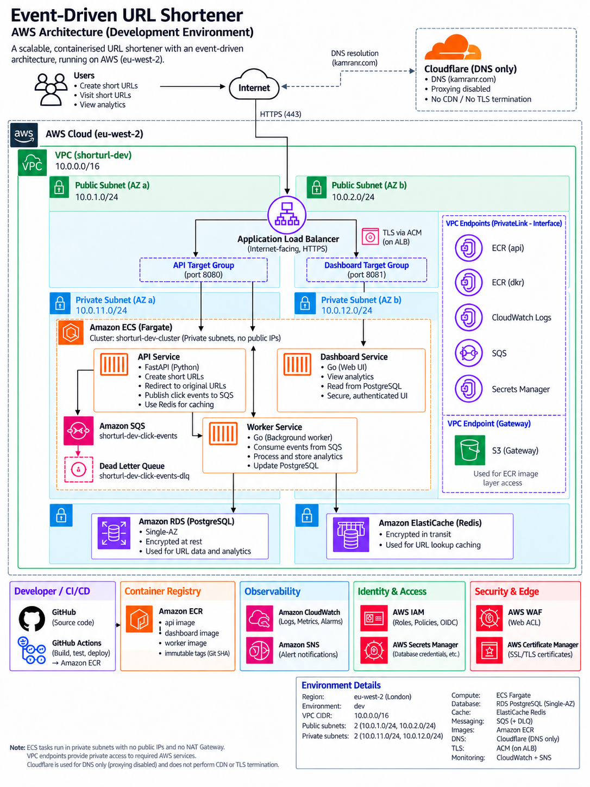
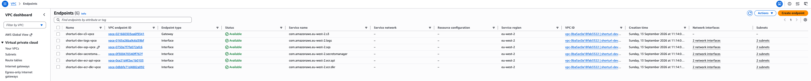
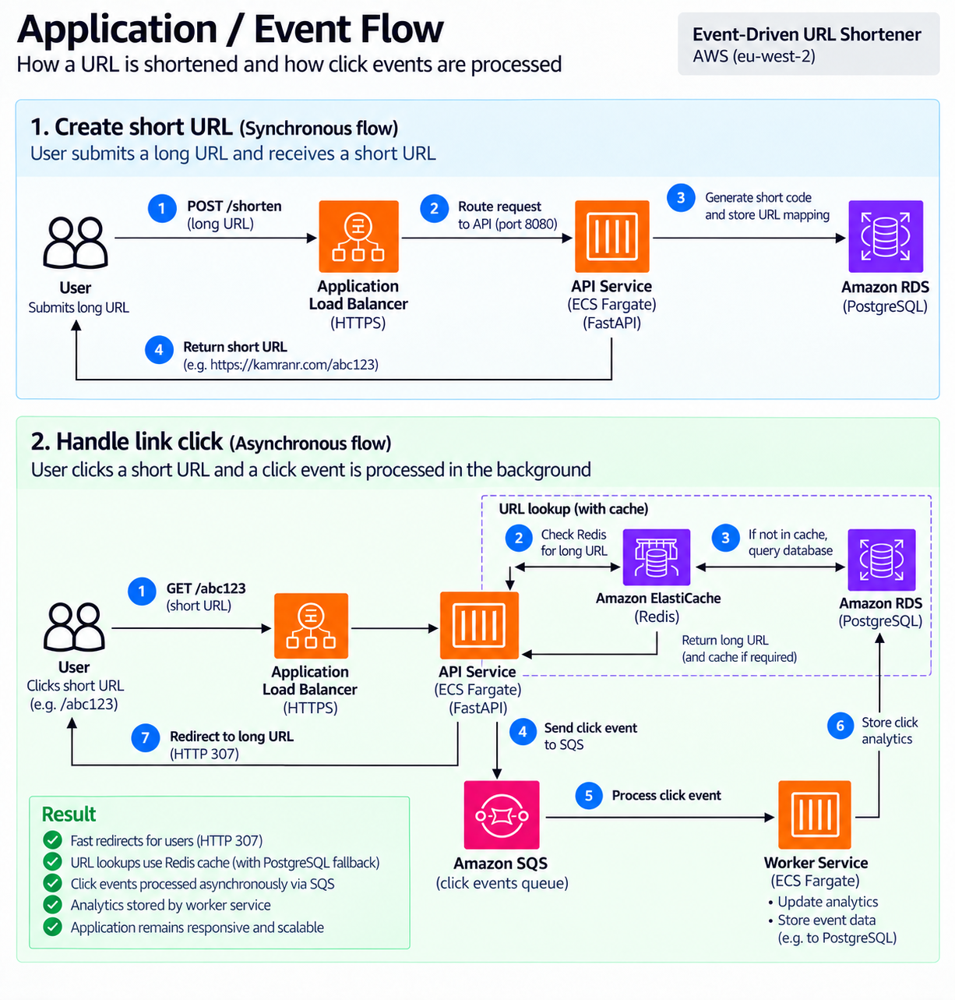
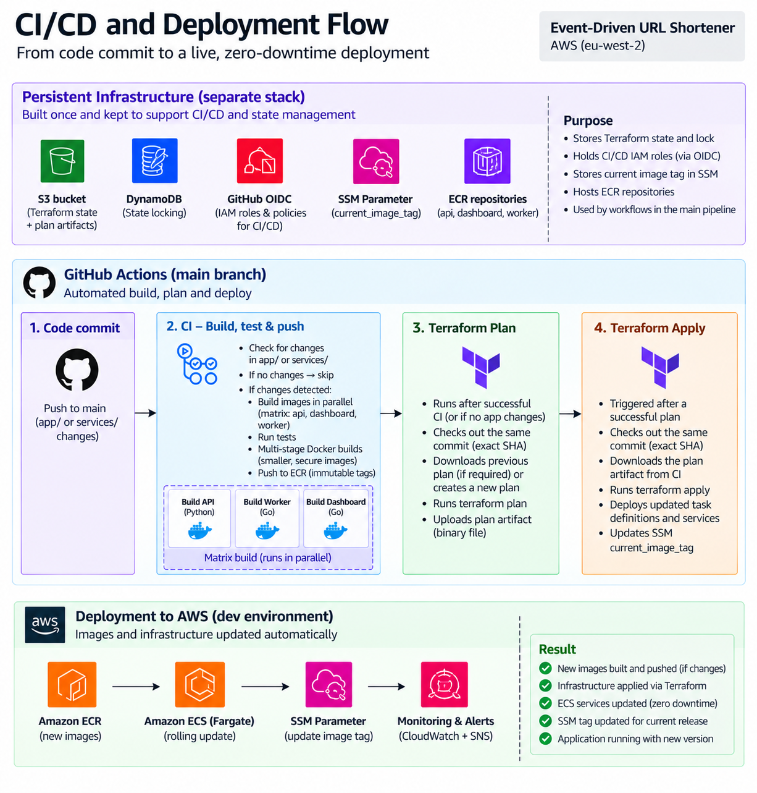
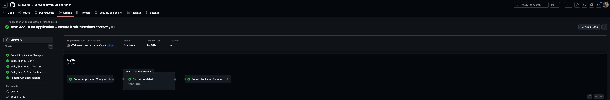
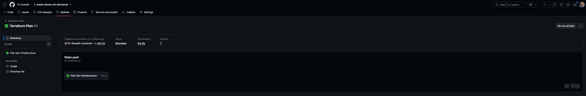
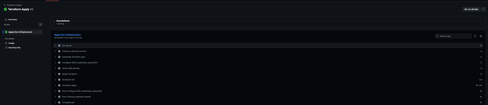
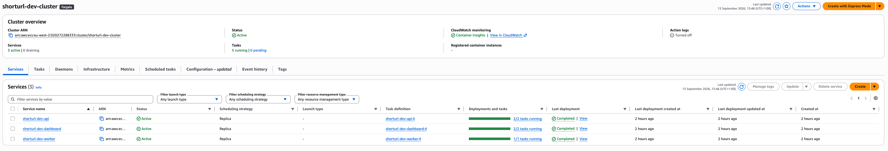
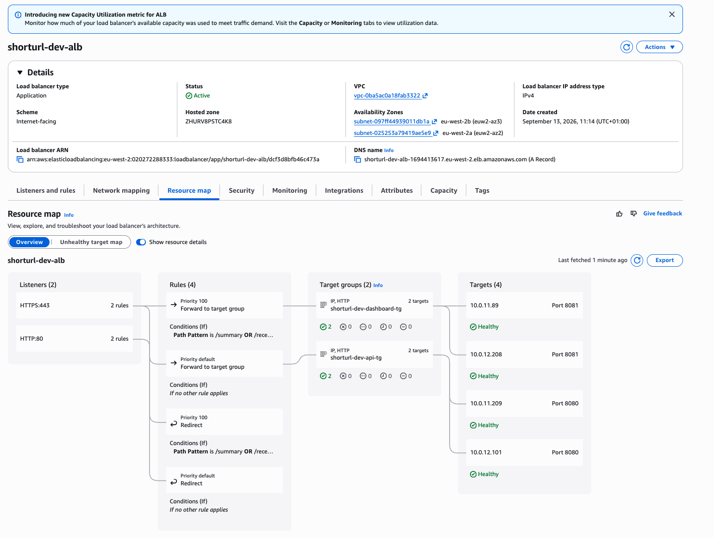
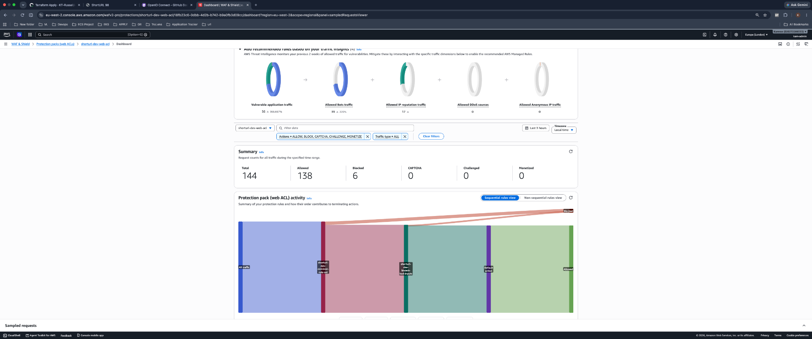

# Event-Driven URL Shortener

A production-style URL shortener built on AWS ECS Fargate, with Redis caching, asynchronous click analytics and an automated CI/CD pipeline.

The application is split into three containerised services: a Python FastAPI API, a Go background worker and a Go analytics dashboard. I built the AWS infrastructure, Docker images and deployment pipelines around the application, with a focus on private networking, repeatable deployments, security and understanding how the individual components work together.

## Demo

The application was tested through the public domain by creating a short URL, following the redirect and confirming that the resulting click was processed and appeared in the analytics.

[View the end-to-end URL shortening demo](images/shortenurlexample.mp4)

## Architecture



The application was deployed in `eu-west-2` inside a custom VPC spanning two Availability Zones.

The Application Load Balancer is the public entry point, while the ECS Fargate tasks, RDS PostgreSQL database and ElastiCache Redis cache run privately with no public IP addresses.

The main AWS services used are:

- ECS Fargate for the API, worker and dashboard
- Application Load Balancer for HTTPS traffic and service routing
- RDS PostgreSQL for URL data and click analytics
- ElastiCache Redis for URL lookup caching
- SQS and a Dead Letter Queue for asynchronous click events
- ECR for immutable container images
- Secrets Manager for database credentials
- CloudWatch for logs, metrics and alarms
- SNS for alert notifications
- AWS WAF for protection of the public application
- ACM for TLS
- VPC endpoints for private access to required AWS services

Cloudflare is used for DNS only, with proxying disabled. Application traffic resolves through Cloudflare DNS and then reaches the internet-facing ALB directly, where HTTPS is terminated using ACM.

## Private Networking

One of the main design decisions was running the ECS tasks in private subnets with no public IPs and without a NAT Gateway.

The VPC uses two public and two private subnets across `eu-west-2a` and `eu-west-2b`:

| Subnet | CIDR |
| --- | --- |
| Public AZ A | `10.0.1.0/24` |
| Public AZ B | `10.0.2.0/24` |
| Private AZ A | `10.0.11.0/24` |
| Private AZ B | `10.0.12.0/24` |

Instead of using a NAT Gateway for access to AWS services, the environment uses Interface VPC endpoints for:

- ECR API
- ECR Docker
- CloudWatch Logs
- SQS
- Secrets Manager

An S3 Gateway endpoint is also used for the ECR image-layer access required when Fargate pulls container images.



This allows the Fargate tasks to pull images, send logs, communicate with SQS and access secrets without needing general internet access through a NAT Gateway.

Security groups restrict traffic between the components. The ALB can reach the API on port `8080` and dashboard on `8081`. Application services can reach PostgreSQL on `5432`, while the API can reach Redis on `6379`.

## Application Flow



### Creating a Short URL

A user submits a long URL using `POST /shorten`.

The request reaches the Application Load Balancer over HTTPS and is routed to the FastAPI service on port `8080`.

The API generates the short code and stores the URL mapping in PostgreSQL before returning the generated short URL to the user.

### Redirects and Click Analytics

When somebody visits a short URL, the request is routed back to the API.

The API checks Redis first for the original URL. If the value is not cached, it falls back to PostgreSQL and can cache the result for future lookups.

Once the URL has been resolved, the API returns an HTTP `307` redirect to the original URL.

Click analytics are handled separately from that user-facing path. The API publishes a click event to SQS, allowing the redirect to complete without waiting for analytics processing.

The Go worker consumes the event from SQS and stores the click analytics in PostgreSQL. If an event repeatedly fails processing, the SQS redrive policy moves it to the Dead Letter Queue rather than allowing it to continuously cycle through the main queue.

The dashboard reads the stored analytics from PostgreSQL and exposes information such as total clicks, recent activity and URL statistics.

This keeps the user-facing redirect path separate from the background analytics workload.

## Why PostgreSQL?

I chose RDS PostgreSQL rather than DynamoDB because the application has relational URL and click data which is queried by the analytics dashboard.

PostgreSQL made those query patterns straightforward and fitted naturally with the worker and dashboard implementation.

DynamoDB could have reduced some of the database management involved, but for this project I felt PostgreSQL was the better fit for the analytics and reporting side of the application.

For this development environment, the RDS instance was deployed as Single-AZ. It was encrypted at rest, not publicly accessible and its credentials were managed through AWS Secrets Manager rather than being stored in the repository or GitHub Actions.

## CI/CD and Deployment



The deployment setup is split between bootstrap infrastructure, persistent infrastructure and the main development environment.

The bootstrap layer establishes the Terraform backend used for remote state.

The persistent stack contains resources that need to remain available independently of the development environment, including the GitHub OIDC/IAM configuration, ECR repositories and the SSM parameter used to track the current published image tag.

The development environment contains the application infrastructure itself, including the VPC, ECS services, ALB, RDS, Redis, SQS, WAF and supporting resources.

### Application CI

A push to `main` starts the application CI workflow.

The workflow first checks whether application code under `app/` or `services/` has changed.

When application changes are detected, the API, worker and dashboard are built using a matrix strategy. This allows all three image jobs to run in parallel rather than building them sequentially.

Each service uses a multi-stage Docker build so build dependencies do not need to be carried into the final runtime image.

The workflow runs the required tests and security scanning before pushing successful images to ECR using immutable Git commit SHA tags.

The release is only recorded after the required image jobs have completed successfully.



GitHub Actions authenticates to AWS using OIDC and short-lived AWS credentials. Long-lived AWS access keys are not stored in GitHub.

### Terraform Plan

After the CI stage completes successfully, or where no new application image needs to be built, the Terraform Plan workflow handles the infrastructure plan for the intended commit.



The workflow checks out the commit being planned and runs Terraform against the development environment.

The resulting binary Terraform plan is uploaded as a workflow artifact so the deployment stage can apply the plan that was actually reviewed and generated.

### Terraform Apply

A successful Terraform Plan triggers the Terraform Apply workflow.



The apply workflow:

1. Checks out the commit that was planned
2. Downloads the Terraform plan artifact
3. Authenticates to AWS using GitHub OIDC
4. Verifies the AWS identity
5. Initialises Terraform
6. Applies the downloaded plan

This means the apply workflow does not generate a new plan immediately before deployment. It applies the saved plan associated with the planned commit.

The overall merge-to-live process is:

`Push to main -> Application CI -> ECR -> Terraform Plan -> Saved Plan Artifact -> Terraform Apply -> ECS Deployment`

This gives me a clear link between the code revision, container image and infrastructure configuration being deployed.

## ECS Deployment

All three applications run as separate Fargate services inside a single ECS cluster.

The deployed environment used:

| Service | Desired Tasks | Purpose |
| --- | ---: | --- |
| API | 2 | URL creation and redirects |
| Dashboard | 2 | Analytics interface |
| Worker | 1 | Background click-event processing |



The API and dashboard are connected to separate ALB target groups. The worker is an internal background service and does not receive user traffic through the ALB.

The deployed ALB showed two healthy API targets on port `8080` and two healthy dashboard targets on port `8081`, spread across the two Availability Zones.



### Zero-Downtime Deployments

ECS uses rolling deployments so replacement tasks can start and become healthy before existing tasks are removed.

The API and dashboard use ALB target health checks to determine whether the replacement application tasks are healthy before traffic is sent to them.

The ECS deployment configuration also uses the deployment circuit breaker with rollback support so a failed deployment can be detected rather than being left running indefinitely.

Successful rolling deployments were tested and reached ECS steady state with the expected tasks running and healthy behind the load balancer.

## Security

I tried to keep the security controls tied to the actual architecture rather than adding services just for the sake of having them in the project.

The main controls include:

- ECS tasks run privately with no public IP addresses
- No NAT Gateway is required
- Security groups restrict traffic between application components
- IAM roles separate ECS execution permissions from application permissions
- GitHub Actions uses AWS OIDC instead of stored AWS access keys
- Database credentials are managed through Secrets Manager
- RDS storage is encrypted
- ECR uses immutable image tags
- HTTPS is terminated at the ALB using an ACM certificate
- AWS WAF protects the internet-facing ALB
- SQS uses a Dead Letter Queue for repeatedly failing events
- Terraform state is stored remotely

The WAF uses AWS managed rule groups for common web application threats and known bad inputs.



During testing, the WAF was actively processing real application traffic. The captured dashboard showed 144 requests processed, with 138 allowed and 6 blocked.

## Observability

Each ECS service sends its application logs to CloudWatch.

CloudWatch alarms monitor areas including ECS service availability, unhealthy ALB targets and load balancer 5xx responses. Alerts can then be sent through SNS to the configured email subscription.

This provided visibility into both the applications and the infrastructure they were running on.

## End-to-End Testing

I tested the complete application path after deployment rather than stopping once Terraform had successfully applied.

The end-to-end test covered:

1. Creating a short URL through the live application
2. Receiving the generated short URL
3. Visiting the short URL
4. Confirming the HTTP redirect worked
5. Confirming the click event was published to SQS
6. Confirming the worker processed the event
7. Confirming the analytics were stored in PostgreSQL
8. Confirming the updated analytics were visible through the application

The deployed environment also had all three ECS services active, with two API tasks, two dashboard tasks and one worker task running.


## Infrastructure as Code

The AWS environment is managed with Terraform and split into reusable modules rather than keeping the entire environment in one large configuration.

The repository separates bootstrap, persistent and environment-specific infrastructure so that resources required by Terraform and the deployment process can exist independently from the application environment.

This also meant I could destroy the development environment when it was no longer needed without deliberately removing the persistent CI/CD and state-management foundation.

At the end of the project, I destroyed the development environment through Terraform rather than manually deleting resources from AWS. This removed 102 managed resources and avoided leaving services such as the ALB, RDS, ElastiCache and WAF running unnecessarily.

## Repository Structure

```text
.
├── app/                         # Python FastAPI API
├── services/
│   ├── worker/                  # Go background worker
│   └── dashboard/               # Go analytics dashboard
├── terraform/
│   ├── bootstrap/               # Terraform backend bootstrap
│   ├── persistent/              # Persistent CI/CD and release infrastructure
│   ├── environments/
│   │   └── dev/                 # Development environment
│   └── modules/                 # Reusable Terraform modules
├── .github/
│   └── workflows/               # CI, plan, apply and destroy workflows
├── images/                      # Architecture diagrams and deployment evidence
└── docker-compose.yml           # Local development environment
```

## Running Locally

The complete application can also be run locally using Docker Compose.

### Requirements

You will need:

- Docker
- Docker Compose
- Git

Clone the repository:

```bash
git clone https://github.com/KT-Russell/event-driven-url-shortener.git
cd event-driven-url-shortener
```

Start the environment:

```bash
docker compose up --build
```

Docker Compose starts the three application services alongside PostgreSQL, Redis and LocalStack.

| Service | Local Port |
| --- | ---: |
| API | `8080` |
| Dashboard | `8081` |
| Worker health endpoint | `8090` |
| PostgreSQL | `5432` |
| Redis | `6379` |
| LocalStack | `4566` |

Check that the API is healthy:

```bash
curl http://localhost:8080/healthz
```

Create a short URL:

```bash
curl -X POST http://localhost:8080/shorten \
  -H "Content-Type: application/json" \
  -d '{"url":"https://example.com"}'
```

The response contains the generated short code, which can then be used through the API to test the redirect.

The dashboard is available locally on:

```text
http://localhost:8081
```

The local environment uses PostgreSQL, Redis and LocalStack so the main application and event flow can be tested without deploying the AWS infrastructure.

To stop the environment:

```bash
docker compose down
```

To stop the environment and remove its local volumes:

```bash
docker compose down -v
```

## What I Took From the Project

The main value of this project for me was bringing together areas I had previously worked with separately.

Rather than just deploying containers, I had to think about how the services communicate, how private Fargate tasks access AWS services, how a release moves from a commit in GitHub through to ECS, where secrets should live, how asynchronous events are handled and how I can tell whether a deployment is actually healthy.

It gave me a much better understanding of the full path from application code, through CI/CD and infrastructure, to a running service.